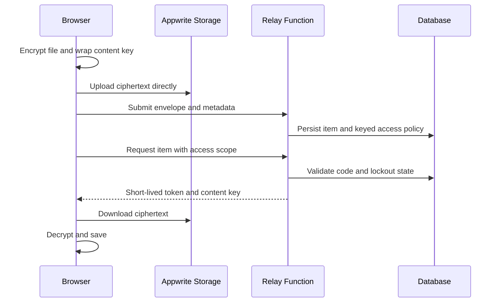

# Obsidian Relay

Obsidian Relay transfers encrypted files through Appwrite with scoped download access and browser-side decryption.

File transfer becomes awkward when the data plane and application API share the same request-size limits. Obsidian uploads ciphertext directly to storage and uses a small function request for the encrypted envelope, metadata and access policy. This separates large-file transfer from authorization logic.

[Quick start](#quick-start) · [How it works](#how-it-works) · [Development](#development) · [Contributing](CONTRIBUTING.md)

## Quick start

Provision an Appwrite project with Functions, Storage and Databases. Use the Node.js 22 runtime for the function. Generate a private RSA key locally; do not commit the generated key or deploy it as a public site asset.

From a fresh checkout:

```bash
git clone https://github.com/ryash14/Obsidian.git
cd Obsidian
node tools/generate-key.mjs
# Configure Appwrite project/endpoint and site functionUrl.
# Install and authenticate the Appwrite CLI first.
appwrite login
appwrite push functions
appwrite push sites
```

Deploy the function with Node.js 22 and entrypoint `src/main.js`. Set `VAULT_RSA_PRIVATE_KEY` from the generated key, grant database/storage/token scopes, and add the site hostname as an Appwrite Web platform. Keep private keys private. Set `sites/obsidian-relay/config.js` to the function URL. Restrict `ALLOWED_ORIGINS` for deployment. The server can unwrap content keys; this is not encryption against the server operator. Rotating the RSA key makes existing items unreadable.

## Appwrite configuration

| Item | Required configuration |
|---|---|
| Function | Node.js 22, entrypoint `src/main.js`, execution access appropriate to the relay |
| `VAULT_RSA_PRIVATE_KEY` | Private key generated by `tools/generate-key.mjs` |
| Function scopes | Database/table/schema operations, storage operations and file tokens used by the relay |
| Site API URL | Set `window.RELAY_CONFIG.functionUrl` in `sites/obsidian-relay/config.js` |
| Web platform | Register the deployed site's hostname in the Appwrite project |
| `ALLOWED_ORIGINS` | Restrict API access to the intended site origins |
| `RELAY_MAX_BYTES` | Keep the file-size limit within the storage bucket and plan limits |
| `ACCESS_MAX_FAILURES`, `ACCESS_LOCK_SECONDS` | Failed-code lockout policy |

After deployment, request `/config` on the function domain to check configuration and schema provisioning. Use a small non-sensitive file to verify upload, authorized download and incorrect-code handling before relying on the relay.

## How it works

1. The browser encrypts each file with a fresh AES-GCM key and wraps that key for the function.
2. Ciphertext uploads directly to Appwrite Storage in chunks.
3. The relay function validates the envelope and records the item under the open index or an access code.
4. A later request is authorized before a short-lived file token and content key are returned. The browser decrypts the downloaded file.

### Component boundaries



### Design decisions

Appwrite Storage holds ciphertext; the database holds item metadata, keyed access-code hashes and failed-attempt state. The function provisions its schema and bucket on first use when its scopes permit it.

This protects stored file contents, but the server can unwrap the content key. It is not end-to-end encryption against the server operator. Filenames, types and sizes remain available to the application. Rotating the RSA key invalidates existing wrapped keys and access-code hashes.

## Implementation

**Stack:** JavaScript · Node.js 22 · Web Crypto · Appwrite Functions · Appwrite Storage and Databases.

- [appwrite.config.json](appwrite.config.json)
- [functions/relay-api/src/main.js](functions/relay-api/src/main.js)
- [functions/relay-api/src/envelope.js](functions/relay-api/src/envelope.js)

## Development

Run the repository checks after completing setup:

```bash
node --check functions/relay-api/src/main.js
node --check functions/relay-api/src/envelope.js
```

Use the offline checks during development. Run provider-backed integration checks separately with configured credentials and representative inputs.

## Contributing and support

Report reproducible bugs or propose changes through [GitHub Issues](https://github.com/ryash14/Obsidian/issues). Include the relevant environment and a small example rather than private datasets or credentials. See [contributing](CONTRIBUTING.md), [security reporting](SECURITY.md) and the [code of conduct](CODE_OF_CONDUCT.md).

## License

No repository-wide license is currently provided. Third-party components, models and datasets retain their own terms.
