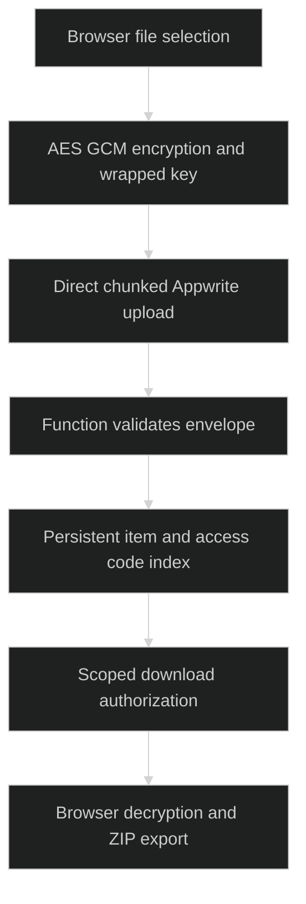

# Obsidian Relay

> `Encrypted file transfer with Appwrite storage, scoped access and browser-side decryption.`

### 🏗️ System Architecture



### 🛠️ Production Stack

JavaScript · Node.js 22 · Web Crypto · Appwrite Functions · Appwrite Storage and Databases

### ⚡ Key Engineering Capabilities

- File contents upload as ciphertext directly to storage.
- The function validates metadata and applies keyed access-code checks and lockouts.
- Persistent database records and short-lived file access support retrieval without RAM-only state.

### 🚀 Deployment and Local Setup

Run from the repository root after cloning:

```bash
git clone https://github.com/ryash14/Obsidian.git
cd Obsidian
node tools/generate-key.mjs
# Configure Appwrite project/endpoint and site functionUrl.
# Install and authenticate the Appwrite CLI first.
appwrite login
appwrite push functions
appwrite push sites
```

Deploy the function with Node.js 22 and entrypoint `src/main.js`. Set `VAULT_RSA_PRIVATE_KEY` from the generated key, grant database/storage/token scopes, and add the site hostname as an Appwrite Web platform. Keep private keys private. Set `sites/obsidian-relay/config.js` to the function URL. Restrict `ALLOWED_ORIGINS` for deployment. The server can unwrap content keys; this is not encryption against the server operator. Rotating the RSA key makes existing items unreadable.

### Verification

```bash
node --check functions/relay-api/src/main.js
node --check functions/relay-api/src/envelope.js
```

These commands are provided by the source configuration; this documentation update does not claim a fresh end-to-end application run.

### Source Map

- [appwrite.config.json](appwrite.config.json)
- [functions/relay-api/src/main.js](functions/relay-api/src/main.js)
- [functions/relay-api/src/envelope.js](functions/relay-api/src/envelope.js)
